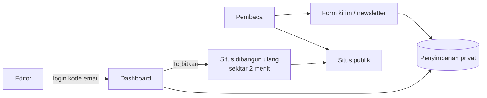

# Cara kerja situs Archaeology of Our Own

Dokumen ini menjelaskan dengan bahasa sehari-hari bagaimana situs bekerja, apa yang disimpan, dan siapa bisa melakukan apa. Versi teknisnya ada di `ARCHITECTURE-SPINE.md`. Setiap bagian di sini menyebut nomor keputusan teknisnya (AD-…), supaya pembaca dan developer membicarakan hal yang sama.

## Tiga bagian situs

| Bagian | Untuk siapa | Isinya |
| --- | --- | --- |
| Situs publik | Semua pembaca | Beranda, artikel, Artefak Hari Ini, seri editorial, catatan privasi. Bahasa Indonesia dan Inggris. |
| Form kirim artefak dan newsletter | Pembaca yang ingin ikut | Mengirim foto dan cerita artefak; mendaftar kabar terbaru. |
| Dashboard redaksi (`/admin`) | 2 editor | Menulis dan menerbitkan artikel, mengelola artefak, meninjau kiriman, mengelola pelanggan. |

Ketiganya berjalan sebagai satu aplikasi di Cloudflare, paket gratis (AD-1). Alamat sementara memakai subdomain `workers.dev` dengan nama netral. Domain `archaeologyofourown.com` bisa dipasang nanti tanpa mengubah situs.

## Bagaimana artikel terbit

1. Editor menulis di dashboard, dengan editor blok mirip Notion. Tulisan tersimpan otomatis sebagai draf beberapa detik setelah berhenti mengetik. Draf tidak pernah tampil di situs (AD-14).
2. Editor menekan **Pratinjau** untuk melihat tampilan persis seperti nanti di situs (AD-6).
3. Editor menekan **Terbitkan**. Situs dibangun ulang otomatis dan artikel tampil dalam sekitar 2 menit. Dashboard menunjukkan statusnya: menunggu, dibangun, tayang, atau gagal (AD-3).
4. Kalau artikel yang sudah tayang diubah, perubahan baru tampil setelah editor menekan **Perbarui**. Jadi tulisan yang setengah jadi tidak pernah bocor ke pembaca (AD-14).
5. Kalau build gagal, situs lama tetap tayang dan editor bisa mencoba lagi.

Halaman publik sudah jadi sebelum pembaca datang. Karena itu situs cepat dan tetap bisa dibuka walaupun database sedang bermasalah (AD-2).

## Bagaimana kiriman artefak ditangani

1. Pembaca mengisi form di `/kirim`. Foto diperkecil dan dibersihkan dari data lokasi di browser mereka sendiri, lalu diunggah satu per satu dengan tanda progres (AD-8, AD-13).
2. Situs memeriksa bahwa file benar-benar foto (JPG, PNG, atau WebP, maksimal 10 MB) dan tidak menyimpan lokasi GPS. File lain ditolak.
3. Kiriman masuk ke penyimpanan privat dengan status *menunggu*. Kiriman dan fotonya tidak punya alamat publik dan tidak pernah tampil otomatis.
4. Editor meninjau di dashboard: setujui, tolak dengan alasan singkat, atau jadikan artefak. Saat dijadikan artefak, foto bisa dipotong dan diputar, dan salinannya yang dipakai di situs (AD-15).

## Data yang disimpan, dan berapa lama

| Data | Disimpan | Berapa lama | Siapa bisa melihat |
| --- | --- | --- | --- |
| Email pelanggan newsletter | Email, bahasa, tanggal daftar | Sampai pemiliknya minta dihapus | Editor |
| Kiriman artefak | Nama atau samaran, email, cerita, foto, persetujuan | Sampai diminta dihapus; kiriman yang ditolak dihapus otomatis setelah 90 hari (AD-10) | Editor |
| Alamat IP pengunjung | Tidak disimpan. Hanya kode acak dari IP yang disimpan maksimal 1 jam untuk mencegah spam (AD-9) | 1 jam | Tidak ada |
| Log aktivitas dashboard | Siapa mengubah apa dan kapan, hanya berupa nomor (tanpa nama atau isi) | Selama situs berjalan | Editor |
| Cadangan database | Salinan otomatis Cloudflare | 7 hari (paket gratis) | Pemilik akun |

Kalau seseorang minta datanya dihapus, permintaan itu hanya diproses dari email yang tersimpan. Penghapusan juga menarik artefak yang berasal dari kirimannya dan menghapus fotonya.

## Keamanan

- **Login dashboard**: hanya 2 email editor yang terdaftar. Login memakai kode sekali pakai yang dikirim ke email, tanpa kata sandi. Setiap permintaan ke dashboard diperiksa ulang di server, bukan hanya di pintu masuk (AD-7).
- **Batas kirim**: 5 kiriman dan 20 pendaftaran newsletter per jam per jaringan, maksimal 100 kiriman per hari dan 5 GB foto kiriman secara total, plus pemeriksaan anti-bot Turnstile (AD-9).
- **File berbahaya**: situs menentukan sendiri jenis file dari isinya. File yang menyamar sebagai gambar ditolak, dan gambar disajikan dengan pengaturan yang mencegahnya dijalankan sebagai skrip (AD-8, AD-17).
- **Build terpisah dari data pribadi**: saat situs dibangun ulang, proses build hanya menerima isi yang sudah terbit, tanpa email atau data pribadi (AD-2).
- **Repo kode publik**: kode boleh dilihat siapa saja, tapi tidak memuat email, nama asli, atau kunci rahasia.

## Biaya

| Layanan | Paket | Catatan |
| --- | --- | --- |
| Cloudflare Workers, D1, R2, Durable Objects, Turnstile, Access | Gratis | Cukup untuk awal: sekitar 100 ribu permintaan dinamis per hari (halaman statis tidak dihitung), 10 GB penyimpanan foto. Kalau situs ramai, upgrade ke paket berbayar sekitar USD 5 per bulan tanpa mengubah situs. |
| Domain `.com` | Dibeli sendiri nanti | Belum dibeli. |

## Yang belum ada di versi pertama

- Email pemberitahuan ke editor saat ada kiriman baru, dan email ke kontributor saat kiriman diputuskan.
- Pengiriman newsletter (v1 hanya mengumpulkan pendaftar).
- Pencarian dan halaman daftar semua artikel.
- Domain sendiri dan alamat terpisah khusus dashboard.

## Yang dibutuhkan dari klien sebelum situs dibuka untuk umum

1. 4 artikel asli, satu per seri (Temuan, Jejak Proses, Ingatan Bersama, Stratigrafi), dalam bahasa Indonesia dan Inggris.
2. 6 artefak asli dengan foto yang boleh dipakai.
3. Kalimat manifesto final.
4. Persetujuan teks catatan privasi dan teks persetujuan kontributor.
5. Kontak yang ditawarkan kalau pemeriksaan anti-bot gagal.

Sebelum semua itu siap, situs boleh berjalan di alamat sementara dengan konten bertanda *Placeholder* dan tidak muncul di mesin pencari (AD-18).
