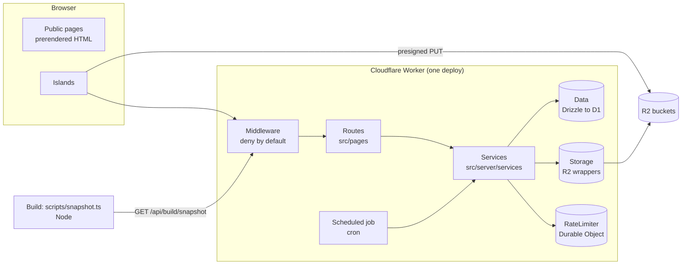
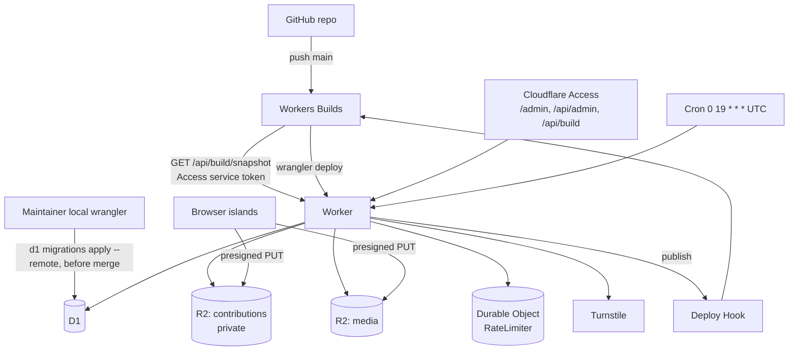
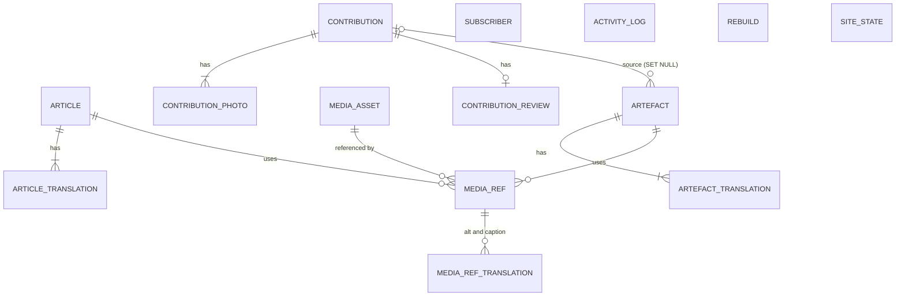

# Architecture Spine: Archaeology of Our Own

## Design Paradigm

**Static-first site with a thin edge API**, layered inside one Cloudflare Worker on the **Workers Free plan**:

- **Routes** (`src/pages/**`): Astro pages and API endpoints. Public pages are prerendered at build; `/admin/**`, `/api/**` and `/media/**` render on demand and export `prerender = false`. Routes parse input, call one service, shape the response. No business logic, no Drizzle, no R2 calls.
- **Services** (`src/server/services/**`): one module per aggregate (articles, artefacts, contributions, subscribers, media, rebuilds, activity, ratelimit). All rules and every write live here. Services receive a `Db` instance and storage handles as parameters; none imports a binding at module level.
- **Data and storage** (`src/server/db/**`, `src/server/storage/**`): the Drizzle schema and client factory, the R2 wrappers and the presigner. Only services import them.
- **Islands** (`src/islands/**`): React components hydrated only where interaction is needed (admin: block editor, crop, review sheet, media uploader; public: contribution uploader, Artefact of the Day swap, menu). Islands talk to the server only through `/api/**` and to R2 only through presigned PUT URLs.



Allowed dependency direction: Routes → Services → Data/Storage. Islands → `/api/**` and presigned R2 URLs only. Scheduled job → Services. The build script reaches data only through `/api/build/snapshot`. Nothing depends upward.

## Invariants & Rules

### AD-1: One Worker with static assets hosts everything [ADOPTED]

- **Binds:** all
- **Prevents:** split deployments with diverging bindings, configs and auth; unprotected preview hosts running production bindings.
- **Rule:** The whole product ships as one Cloudflare Worker built by `@astrojs/cloudflare` with static assets, on the **Workers Free plan** (10 ms CPU and 128 MB per request; designs must fit it). Cloudflare Pages is not used. `assets.run_worker_first` covers `/admin/*`, `/api/*` and `/media/*`; every other path is served from static assets with `assets.not_found_handling: "404-page"`. `preview_urls: false`; Workers Builds builds `main` only (no branch builds). Adapter: `imageService: 'passthrough'` (images are sized in the crop island, AD-15); Astro sessions are not used and no `SESSION` KV namespace is provisioned `[ASSUMPTION: confirm the adapter opt-out at setup; if it cannot be removed it gets a neutral name]`. The account's `workers.dev` subdomain, the Zero Trust team domain, the Turnstile widget and every resource name (Worker, D1, buckets, Durable Object) are neutral project names, never derived from a personal email or name. `observability.logs.invocation_logs: false`.

### AD-2: Public pages never query D1 at request time; the build reads a public DTO snapshot [ADOPTED]

- **Binds:** FR-1–FR-10, FR-23–FR-25, FR-33
- **Prevents:** public pages depending on database availability; the build or a dependency reading personal data; private fields leaking into static HTML.
- **Rule:** Every public page (home, Article, privacy, contribute, 404) is prerendered by `astro build`. Prebuild `scripts/snapshot.ts` (Node) fetches `GET /api/build/snapshot`, authenticated by a Cloudflare Access service token set only in Workers Builds variables; the build token has **no D1 rights**. The endpoint maps rows through Zod `.strict()` public DTOs in `src/shared/public.ts` (`PublicArticle`, `PublicArtefact`, `PublicMedia`) and includes only the published copy (AD-14) of published translations, plus the current `content_version` (AD-3). The snapshot step renders Article HTML in Node (AD-6) and writes `src/content/snapshot/*.json`; Astro content collections load only that snapshot. Islands receive only DTO fields they render. A post-build check fails the deploy if `dist/` contains an email pattern, an `AOO-` Reference Number, or any path under `admin`. Public runtime endpoints are only `POST /api/subscribe`, `POST /api/contribute/start`, `POST /api/contribute/finish` and `GET /media/*`.

### AD-3: Publishing is a rebuild that must reach a content version [ADOPTED]

- **Binds:** FR-27, FR-28, FR-33
- **Prevents:** content going live through a side path; a publish lost to coalescing; autosave firing rebuilds; two writers of rebuild status.
- **Rule:** A single integer `content_version` (table `site_state`) is incremented in the same D1 batch as every publish, Perbarui (update-published), unpublish, and delete of published content. Only those service functions call `rebuilds.request(version)`; autosave, drafts, conversion, review decisions and Subscriber changes never do. `request()` records a `rebuilds` row with the target version and POSTs the Deploy Hook (secret `DEPLOY_HOOK_URL`); the platform dedupes a queued build and returns `build_uuid`, stored on the row. The build writes the snapshot's version to `dist/version.json`. One writer, `rebuilds.refresh()` (called by the Dashboard status poll and the cron), polls the Workers Builds API with runtime secret `BUILDS_READ_TOKEN` (Builds read only) and moves rows forward only: `queued` → `building` → `live` | `failed`. A row is `live` only when the deployed `/version.json` is at or above its target version; if a build succeeded below it, `refresh()` fires the hook again. A failed rebuild leaves the previous deployment live.

### AD-4: Single typed schema; services own every write; migrations before deploy

- **Binds:** all data FRs, FR-34
- **Prevents:** two units shaping the same entity differently; writes bypassing rules; services unusable outside the Worker; code deployed against an older schema; personal data surviving in the activity log.
- **Rule:** `src/server/db/schema.ts` (Drizzle) is the only definition of D1 tables; migrations are generated with drizzle-kit, additive-only in v1, and applied by the maintainer locally with `wrangler d1 migrations apply --remote` **before** the change is merged to `main`; neither the build nor Workers Builds holds D1 rights, so code merged to `main` always meets a schema that already has its columns. Services take a `Db` (Drizzle client) argument; the Worker builds it from the D1 binding, scripts and tests build it from local or remote D1. Every service that writes R2 then D1 deletes its R2 objects on failure, and the cron sweeps leftovers (AD-10). Every create, update, delete, publish, review decision and deletion-on-request writes an `activity_log` row in the same D1 batch (FR-34). `activity_log` columns are fixed: `id, at, actor, action, entity_type, entity_id, ref`. `actor` is the verified Editor email, or the literal `public` or `system`. `ref` holds only a Reference Number or slug. No subject email, name, story text or note is ever copied into it. Deletion on request sets `ref` to null on that entity's rows. Review notes live on `contribution_review`, deleted with the Contribution.

### AD-5: Entity ownership, identity and enums

- **Binds:** FR-4–FR-9, FR-11–FR-14, FR-17, FR-27–FR-32
- **Prevents:** one-language rows, cross-language slug clashes, guessable identifiers, Publication Status at two levels, Category defined twice.
- **Rule:** Each bilingual entity is a language-neutral parent row plus one translation row per language (`id`, `en`): `article` + `article_translation`, `artefact` + `artefact_translation`. Translatable child fields (image alt text, caption) live on a per-language row (`media_ref_translation`), never as `_id`/`_en` columns. **Publication Status (`draft` · `published`) lives on the translation row**; the parent has none and counts as published when at least one translation is. Slug uniqueness is per (`lang`, `slug`). A translation's slug is locked after its first publish (`published_at` set); no redirects in v1. The Article date (FR-4 ordering and card date) is `article.date`, Editor-set on the parent, defaulting to the first publish time of any translation. A translation may be missing (FR-1). Primary keys are UUID v4 text from `crypto.randomUUID()`. Contribution Reference Numbers are `AOO-` + 6 Crockford base32 characters from a CSPRNG, unique, never sequential (FR-13); a Reference Number alone never authorizes withdrawal. Editorial Series (`temuan`, `jejak-proses`, `ingatan-bersama`, `stratigrafi`) and Category (`budaya-visual`, `proses`, `ingatan`) are fixed enums in `src/shared/enums.ts` with labels in i18n files, used by forms, services and conversion; no table, no free text.

### AD-6: Article body is BlockNote JSON, rendered by one shared function

- **Binds:** FR-6, FR-27, UX block editor
- **Prevents:** preview and public page rendering differently; HTML injection from stored content; GPL code entering the bundle.
- **Rule:** Article bodies are stored as BlockNote document JSON per translation (working and published copies, AD-14). `src/shared/blocks.ts` defines the BlockNote schema, including the custom `catalogueRecord` block (stores only an Artefact ID; the snapshot step resolves it from the published Artefact pool and omits the block when that Artefact is not published), image blocks with per-language alt text and credit, and an inline language mark that renders `lang`. One function `renderArticleHtml(doc, document)` in `src/shared/render.ts` converts JSON to HTML and runs an allowlist sanitizer (tags per block type, attributes per tag, `href` limited to `https:`, `mailto:` and same-site relative, `src` limited to `/media/`, custom blocks emit escaped text only). The build calls it in Node inside `scripts/snapshot.ts` (`@blocknote/server-util` with its DOM); the admin preview calls the same function in the browser with the native DOM. No `set:html` or `dangerouslySetInnerHTML` anywhere except on `renderArticleHtml()` output. Reading time is computed from the published JSON in the same module. Only MPL-2.0 `@blocknote/*` packages are allowed; a CI license check fails on `@blocknote/xl-*` or any GPL/AGPL dependency.

### AD-7: Editor identity is verified on the server; deny by default

- **Binds:** FR-26, FR-30, FR-34
- **Prevents:** the Access edge rule being the only gate; a mutation path outside the protected prefix; forged cross-site requests.
- **Rule:** Cloudflare Access (email one-time PIN, Editor allowlist in the Access policy) protects `/admin/*`, `/api/admin/*` and `/api/build/*` on every hostname, including `workers.dev` `[ASSUMPTION: path-scoped Access app on workers.dev verified at setup; fallback: whole hostname behind Access until launch]`. One middleware runs on every on-demand path and **denies by default**: only `/api/subscribe`, `/api/contribute/*` and `/media/*` are public. On protected paths it verifies `Cf-Access-Jwt-Assertion` with `jose` against `https://<team>.cloudflareaccess.com/cdn-cgi/access/certs`, pinning issuer and AUD, requires an `email` claim listed in secret `EDITOR_EMAILS` (or, for `/api/build/*` only, the service-token identity), and fails closed when the header or config is missing. Mutations exist only under `/api/admin/**` (plus the public endpoints above); Astro Actions and form posts to pages are forbidden; GET never changes state. Non-GET `/api/admin/**` requests require `Content-Type: application/json` and `Sec-Fetch-Site: same-origin` (fallback `Origin` equals host). An expired session returns JSON 401 `session_expired`. Every admin service function takes the verified actor as a required argument. No password, session table or user table exists.

### AD-8: Two buckets; nothing private is addressable; content type comes from bytes

- **Binds:** FR-12, FR-14, FR-29, FR-31
- **Prevents:** a Contribution photo reachable by URL; published images with location data; uploaded bytes executing as script on the Dashboard origin.
- **Rule:** `CONTRIBUTIONS` (private) holds Contribution photos under random keys, read only by `/api/admin/**`. `MEDIA` holds public or soon-public images, served by `GET /media/<key>` where the key matches `^[0-9a-f-]{36}(-w\d+)?\.(jpg|png|webp)$`; no `r2.dev` URL. One shared `sniffImage(bytes)` accepts only JPEG, PNG and WebP by magic bytes and returns the MIME; SVG, HTML and any other type are rejected everywhere; client-declared type and filename are discarded. It also rejects any metadata segment outside a structural allowlist (JPEG: SOI, APP0, APP2 ICC, DQT, SOF, DHT, DRI, SOS, EOI; PNG: critical chunks plus `iCCP`, `sRGB`, `gAMA`, `pHYs`; WebP: `VP8`, `VP8L`, `VP8X` without EXIF/XMP flags, `ALPH`, `ICCP`, `ANIM`, `ANMF`) and images above 40 megapixels. Every upload path re-encodes in the browser before upload (`reencodeImage()` in `src/islands/lib/`: downscale to at most 3000 px on the long edge, JPEG or WebP at quality 0.85, metadata dropped), so the server check is a backstop that returns `photo_metadata`. Responses that return stored bytes (`/media/*`, admin photo route) set the server-derived `Content-Type`, `X-Content-Type-Options: nosniff`, `Content-Security-Policy: default-src 'none'; img-src 'self'; sandbox` and `Content-Disposition: inline; filename="<uuid>.<ext>"`; `/media/*` adds `Cache-Control: public, max-age=31536000, immutable`, admin photos `private, no-store`.

### AD-9: Public write endpoints share one guard chain

- **Binds:** FR-11–FR-15, FR-17–FR-19
- **Prevents:** endpoints with different validation or limits; per-location limits that miss the hourly quota; storing network addresses.
- **Rule:** `POST /api/subscribe` and `POST /api/contribute/start` run in order: reject bodies over 64 KB → hourly limit → Turnstile `siteverify` (check `success`, `hostname`, `action`) → Zod validation with the shared schema (`src/shared/schemas.ts`, `astro/zod`) → service. The hourly limit is `services/ratelimit` backed by one SQLite Durable Object class `RateLimiter`, instance keyed by `HMAC-SHA256(RL_HMAC_KEY, IPv4 address or IPv6 /64)`, holding a count only, deleted by alarm 1 hour after the window opens; limits are 5 per hour for contribute and 20 per hour for subscribe. The same Durable Object class holds one global instance (fixed name) enforcing site-wide caps of 100 Contributions per Asia/Jakarta day and 5 GB total stored Contribution photo bytes; `start` reserves the declared bytes, `finish` corrects them to actual sizes, purges and deletions release them; exceeding either returns `capacity_reached` before any upload URL is issued. The raw IP is never written to D1, R2, Durable Object storage or logs. No upload URL is issued before Turnstile passes. Subscribe returns the same response for new and existing emails (FR-18). `POST /api/contribute/finish` needs the upload token from `start`, not a new Turnstile pass.

### AD-10: Retention and cleanup run in one scheduled job

- **Binds:** FR-21, FR-22, FR-32, FR-33
- **Prevents:** retention logic copied into request handlers; orphaned R2 objects; two definitions of the rejection date.
- **Rule:** One Cron Trigger `0 19 * * *` (UTC, 02:00 WIB) calls, in order: `contributions.purgeRejected()` (Contributions with `rejected_at` older than 90 days: R2 objects first, then rows, plus an activity entry), `contributions.purgeStaleUploads()` and `media.purgeStaleUploads()` (records still `uploading` after 24 hours, with their objects), `media.collect()` (AD-15), a sweep of `CONTRIBUTIONS` objects with no row older than 24 hours, and `rebuilds.refresh()`. `rejected_at` is set and cleared only by `contributions.decide()`; the Dashboard deletion date and the cron both use `rejected_at + 90 days`. Deletion on request (FR-22, FR-32) uses the same service functions and also unpublishes every Artefact whose `source_contribution_id` is that Contribution (bumping `content_version`, AD-3) and deletes the media assets copied from its photos (AD-15). A Contribution referenced by an Artefact cannot be rejected (`decide()` returns `converted_contribution`) until that Artefact is deleted.

### AD-11: Bilingual routing and copy

- **Binds:** FR-1, FR-2, FR-8, UX IA
- **Prevents:** mixed URL schemes and hard-coded strings.
- **Rule:** Astro i18n routing with Indonesian as default without prefix and English under `/en/`. Route pairs: `/` ↔ `/en/`, `/artikel/[slug]` ↔ `/en/articles/[slug]`, `/kirim` ↔ `/en/contribute`, `/privasi` ↔ `/en/privacy`. All interface strings live in `src/i18n/{id,en}.json`; API errors return a `code`, and the client maps it to a localized message. The dashboard UI is Indonesian only.

### AD-12: Design tokens come only from the UX spine

- **Binds:** all UI
- **Prevents:** hand-picked colours or spacing drifting from DESIGN.md; slop creeping in.
- **Rule:** `src/styles/tokens.css` is generated from or hand-mirrored 1:1 to the YAML tokens in the UX `DESIGN.md` (public and admin scopes). Styling is `tokens.css` plus plain component CSS (Astro scoped styles or one CSS file per island); Tailwind is not used. Components use tokens only; no literal colours, radii or font stacks in components. The block editor uses `@blocknote/mantine` with a Mantine theme built from the same tokens. Fonts are self-hosted via `@fontsource-variable/fraunces` (subsets `latin` and `latin-ext` only; only the display weight is preloaded) and `@fontsource-variable/inter`. Public scripts: GSAP loads on the home page only; other public pages use small vanilla scripts. Every new screen passes `antislop` and `unslop` before review.

### AD-13: Photos upload directly to R2 through presigned URLs

- **Binds:** FR-12, FR-13, FR-29, FR-31
- **Prevents:** the Worker buffering photo bodies past Free-plan CPU and memory limits; contribution and editor uploads diverging; unverified bytes becoming public.
- **Rule:** Both contribution photos and editor media use one protocol. (1) `start` (`/api/contribute/start` after AD-9, or `/api/admin/media/start`) validates declared count (contributions 1–5) and sizes (≤ 10 MB each), creates the record with status `uploading`, and returns an upload token plus one presigned R2 PUT URL per file (random key, 10-minute expiry, SigV4 signed in `src/server/storage/presign.ts` with WebCrypto using secrets `R2_ACCESS_KEY_ID`/`R2_SECRET_ACCESS_KEY` scoped to the two buckets). (2) The island PUTs each file directly to R2 with per-file progress and retry; bucket CORS allows PUT from the site origin only. (3) `finish` checks each object with `head` (size ≤ 10 MB) and ranged reads of its first and last 64 KB through `sniffImage()` (AD-8), stores the derived MIME, width and height, deletes failed objects and returns per-file codes. Contribution `finish` assigns the Reference Number and moves the record to `received` (Review Status `pending`). Editor media is staged under `staging/` in `MEDIA` (never matched by `/media/*`) and `finish` copies it by stream to its final key with the derived `Content-Type`. The Worker never reads a whole photo body.

### AD-14: Each translation has a working copy and a frozen published copy

- **Binds:** FR-27, FR-28, FR-33, UX autosave and Perbarui
- **Prevents:** autosave leaking half-edited text into a rebuild; one Editor's unfinished edit shipped by another's publish; silent overwrite between two Editors.
- **Rule:** `article_translation` and `artefact_translation` each hold working fields (written by autosave) and `published_*` fields. Autosave writes only working fields and never calls `rebuilds.request()`. Only explicit **Terbitkan** (first publish) and **Perbarui** (update published) copy working → published, set the translation's Publication Status and `published_at`, bump `content_version` and request a rebuild (AD-3). Unpublish clears the published state for that translation. The snapshot reads only published fields. Every save carries the row's `revision`; a mismatch is rejected with code `edit_conflict`.

### AD-15: `media_asset` owns every MEDIA object

- **Binds:** FR-6, FR-28, FR-29, FR-31
- **Prevents:** broken images after another unit deletes a shared key; live or fallback deployments pointing to deleted objects; converted Artefacts depending on private Contribution photos.
- **Rule:** `services/media` owns table `media_asset` (one row per image, with its WebP width variants, MIME, dimensions, tint and `is_placeholder`) and table `media_ref` (Article hero, body block, Artefact image → asset). The crop island emits WebP at widths 640, 1280 and 2000 (no upscaling), uploaded as variants through AD-13; public pages render `srcset` with explicit dimensions. The tint (light and dark clamped values) is computed in the crop island from the canvas, validated and stored on the asset at ingest; build and the Artefact of the Day swap read the stored value. Deleting a referenced asset is refused. `media.collect()` removes an unreferenced asset's objects only after a rebuild that no longer references it is `live`. Conversion (FR-31) runs each Contribution photo through the crop island and AD-13, creating new `MEDIA` assets; it never references `CONTRIBUTIONS` keys. `artefact.source_contribution_id` is nullable with `ON DELETE SET NULL`.

### AD-16: Artefact of the Day is a static pool with one shared pick

- **Binds:** FR-9, FR-10
- **Prevents:** build HTML and the browser choosing different Artefacts; a daily rebuild; a runtime endpoint for the pool.
- **Rule:** The build writes the published Artefact pool as a static JSON asset of `PublicArtefact` DTOs (with stored tint). One function `pickDaily(poolIds, date)` in `src/shared/daily.ts`, a stable hash of the Asia/Jakarta calendar date over IDs sorted ascending, is used by both the build and the swap island. The prerendered home shows the build-day pick (the no-JS result); the island recomputes for the current Jakarta date on load and swaps if it differs. "Show another" draws from the same JSON. No cron or rebuild runs for the daily change.

### AD-17: Response headers and CSP

- **Binds:** all pages, FR-26, FR-30
- **Prevents:** a public-page script acting with Editor rights on the shared origin; framing and MIME sniffing.
- **Rule:** Static assets get headers from `public/_headers`; on-demand responses get the same from middleware. Pages send `Content-Security-Policy` with `default-src 'self'; script-src 'self'` plus build-generated hashes for Astro inline scripts, `https://challenges.cloudflare.com` and `https://static.cloudflareinsights.com` (Cloudflare Web Analytics beacon, cookieless, public pages only); `connect-src 'self' https://cloudflareinsights.com`; `frame-src https://challenges.cloudflare.com`; `img-src 'self' data:`; `style-src 'self' 'unsafe-inline'`; `object-src 'none'; base-uri 'none'; frame-ancestors 'none'` `[ASSUMPTION: Astro 7 CSP hashing verified at setup]`. All responses send `Strict-Transport-Security`, `X-Content-Type-Options: nosniff`, `Referrer-Policy: strict-origin-when-cross-origin`. Island data goes in a static JSON file or `<script type="application/json">` with `<` escaped, never string-built script. Byte-serving routes use the sandbox CSP in AD-8.

### AD-18: Placeholder flag and launch gate

- **Binds:** FR-25, PRD §6.3, UX Placeholder marker
- **Prevents:** Placeholders shown unlabelled; a pre-launch site indexed by search engines; launching with Placeholders.
- **Rule:** `article`, `artefact` and `media_asset` carry `is_placeholder`; placeholder interface copy is flagged in the i18n files. The renderer shows the Placeholder marker from the flag only. Build variable `PUBLIC_LAUNCH` defaults to false: pages carry `<meta name="robots" content="noindex">`, `_headers` adds `X-Robots-Tag: noindex` and `robots.txt` disallows all. With `PUBLIC_LAUNCH=true` the build fails if any published record or copy string is flagged Placeholder.

## Consistency Conventions

| Concern | Convention |
| --- | --- |
| Naming | Glossary terms from the PRD verbatim in code (`Contribution`, `Artefact`, `EditorialSeries`, `Category`, `ReviewStatus`). Tables snake_case singular; TS types PascalCase; files kebab-case. |
| IDs and time | UUID v4 text keys (`crypto.randomUUID()`); timestamps as ISO 8601 UTC strings; displayed in Asia/Jakarta. |
| API shape | JSON. Success `{ ok: true, data }`; failure `{ ok: false, error: { code, field? } }` with HTTP 4xx/5xx. `code` values are stable snake_case and localized client-side. |
| Validation | One Zod schema (`astro/zod`) per input in `src/shared/schemas.ts`, used by island and endpoint. Emails are trimmed and lowercased by the schema; Subscriber and Contribution emails have a unique or lookup index on that value. |
| Statuses | Publication Status (per translation): `draft` · `published`. Contribution intake: `uploading` · `received`. Review Status: `pending` · `approved` · `rejected`. Media: `uploading` · `ready`. Rebuild: `queued` · `building` · `live` · `failed`. |
| Personal data in admin API | Review endpoints return the masked email; the full address comes only from a reveal endpoint that writes an activity row. Subscriber CSV export prefixes cells starting with `=`, `+`, `-`, `@`, tab or CR with `'`. |
| Errors and logging | Workers Logs with structured `console.log({ event, code, id })` from one route error wrapper; never log emails, story text, IPs, headers, Zod issues or parser `Error.message`. |
| Config and secrets | Bindings in `wrangler.jsonc`. Worker secrets: `TURNSTILE_SECRET`, `DEPLOY_HOOK_URL`, `BUILDS_READ_TOKEN`, `ACCESS_AUD`, `ACCESS_TEAM_DOMAIN`, `EDITOR_EMAILS`, `RL_HMAC_KEY`, `R2_ACCESS_KEY_ID`, `R2_SECRET_ACCESS_KEY`. Public var: Turnstile site key. Workers Builds variables: Access service token ID and secret, `PUBLIC_LAUNCH`. Local values in `.dev.vars` (git-ignored). Missing auth config fails closed. |
| Pipeline | `npm ci --ignore-scripts` (allowlisted install scripts only) → license check → `astro check` and unit tests → `scripts/snapshot.ts` → `astro build` → leak check → `wrangler deploy`. Lockfile committed, exact versions. |
| Migrations | Maintainer runs `wrangler d1 migrations apply --remote` locally before merging any PR that adds a migration (the PR template carries a checkbox for it); migrations stay additive so the live code keeps working against the newer schema until the merge deploys. |
| Analytics | Cloudflare Web Analytics beacon snippet on public pages only, cookieless; no other analytics or tracking. |
| Privacy in repo | No emails, real names or secrets in code, fixtures, docs or commits; fixtures use `contoh.id` and pseudonyms. |

## Stack

| Name | Version |
| --- | --- |
| Node.js (local and build) | 24.22.x |
| Astro | 7.4.12 |
| @astrojs/cloudflare | 14.4.8 |
| Wrangler | 4.164.0 |
| React (islands) | 19.3.1 |
| BlockNote (`core`, `react`, `mantine`, `server-util`), MPL-2.0 | 0.57.0 |
| @mantine/core / @mantine/hooks (BlockNote UI peers), MIT | 9.8.1 / 9.8.1 |
| Drizzle ORM | 0.45.4 |
| drizzle-kit | 0.31.11 |
| GSAP | 3.15.1 |
| jose (Access JWT verification) | 6.2.17 |
| Zod (bundled with Astro via `astro/zod`) | 4.x (as pinned by Astro 7.4.12) |
| Fontsource Fraunces / Inter (variable) | 5.3.0 / 5.3.0 |
| Cloudflare platform | Workers Free plan + static assets, D1, R2, Durable Objects (SQLite), Access, Turnstile, Cron Triggers, Workers Builds, Web Analytics |

## Structural Seed

### System and providers



### Environments

| Environment | Where | Data |
| --- | --- | --- |
| Local | `astro dev` / `wrangler dev` with local D1, R2 and Durable Object | seeded Placeholder fixtures only |
| Production | `archaeologyofourown.<neutral-subdomain>.workers.dev` on Workers Free; custom domain later | real data; Placeholders allowed until launch (AD-18) |
| Preview | none in v1 (`preview_urls: false`, no branch builds) | not applicable |

### Core entities



### Source tree

```text
archaeologyofourown/
  src/
    middleware.ts     # deny-by-default auth, CSRF, headers
    pages/            # public (prerendered); admin/**, api/** and media/[...key].ts (prerender = false)
    islands/          # React islands; lib/ holds reencodeImage()
    components/       # Astro components (public + admin)
    server/
      services/       # articles, artefacts, contributions, subscribers, media, rebuilds, activity, ratelimit
      db/             # schema.ts, client.ts (Db factory), migrations/
      storage/        # r2 wrappers, presign.ts, sniff-image.ts
      durable/        # RateLimiter Durable Object
      auth/           # Access JWT verification
    shared/           # schemas.ts, public.ts (DTOs), blocks.ts, render.ts, daily.ts, enums.ts
    content/snapshot/ # build-time JSON from scripts/snapshot.ts (git-ignored)
    i18n/             # id.json, en.json
    styles/           # tokens.css (mirrors UX DESIGN.md), global.css
  public/_headers
  scripts/            # snapshot.ts (prebuild), check-dist.ts (leak check), seed.ts
  wrangler.jsonc
  astro.config.mjs
```

## Capability → Architecture Map

| Capability / Area | Lives in | Governed by |
| --- | --- | --- |
| Bilingual public site (FR-1–FR-10, FR-23–FR-25) | `src/pages` prerendered, `src/content/snapshot` | AD-2, AD-11, AD-12, AD-16, AD-17, AD-18 |
| Contribution (FR-11–FR-15) | `api/contribute/*`, `services/contributions`, `CONTRIBUTIONS` | AD-8, AD-9, AD-13 |
| Newsletter (FR-17–FR-19) | `api/subscribe`, `services/subscribers` | AD-9 |
| Privacy and retention (FR-20–FR-22) | `services/contributions`, `services/subscribers`, cron | AD-4, AD-10 |
| Editor sign-in (FR-26) | Access + `middleware.ts` + `server/auth` | AD-7, AD-17 |
| Articles and Artefacts CRUD (FR-27, FR-28) | `admin/**`, `islands/editor`, `services/articles`, `services/artefacts` | AD-4, AD-5, AD-6, AD-14 |
| Images (FR-29) | `islands/crop`, `services/media`, `MEDIA` | AD-8, AD-13, AD-15 |
| Review and conversion (FR-30, FR-31) | `admin/kiriman/**`, `islands/review-sheet` | AD-4, AD-7, AD-15 |
| Subscribers and data (FR-32) | `admin/pelanggan`, `services/subscribers` | AD-4, AD-10 |
| Rebuild status (FR-33) | `services/rebuilds`, Deploy Hook, Builds API | AD-3 |
| Activity log (FR-34) | `services/activity` | AD-4, AD-7 |

## Deferred

- **Custom domain** `archaeologyofourown.com`: attaching it is a config change and rebuild (`site`, canonical and OG URLs, Turnstile hostnames, Access app hostnames, bucket CORS), then `workers_dev: false`.
- **Separate admin hostname** (e.g. an `admin.` subdomain on the same Worker, Access on that host only): adopt when the custom domain exists.
- **Email notifications and double opt-in** (PRD v2): would add Cloudflare Email Service; out of v1.
- **Search and Article index page**: not in v1 scope.
- **Observability beyond Workers Logs** (alerts, Logpush): add if traffic warrants; failed rebuilds surface in the Dashboard only.
- **Exact motion timings and build-level UX assumptions**: resolved during implementation per UX EXPERIENCE.md.
- **Backups**: D1 Time Travel gives 7-day point-in-time restore on the Free plan (deleted personal data persists there for that window); R2 has no backup in v1; a scheduled export is deferred until real content exists.
- **Drizzle 1.0**: stay on 0.45.x and drizzle-kit 0.31.x; migrate deliberately when 1.0 is final.
- **Workers Paid plan**: only if Free-plan CPU, request or Durable Object quotas are hit.
